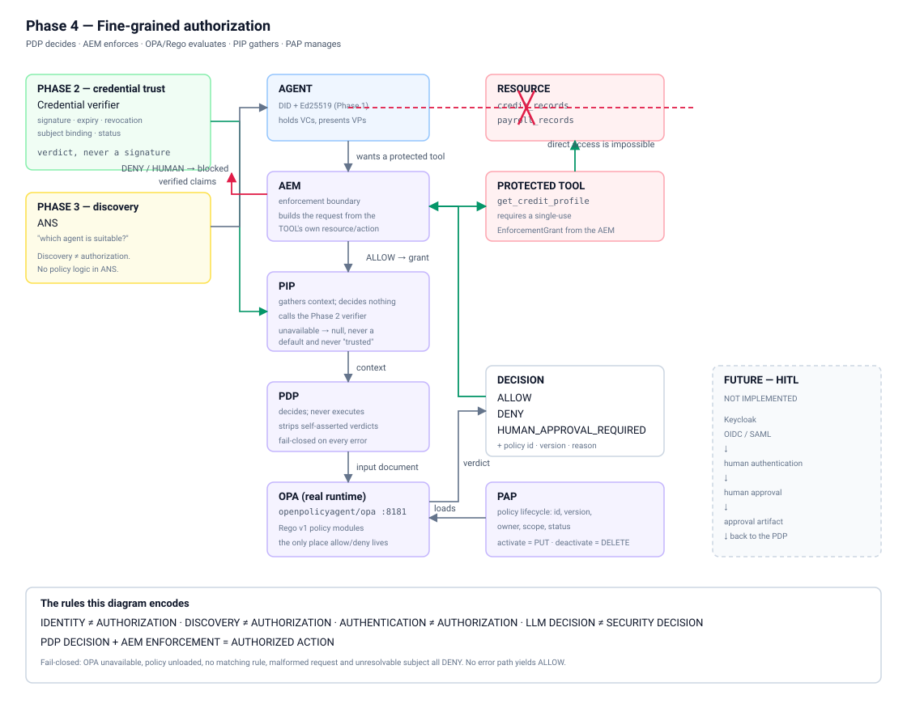

# Phase 4 — fine-grained authorization

Moving from *"which agent can perform this task?"* to *"is **this** agent
allowed to perform **this** action on **this** resource under **this**
context?"*



---

## 1. The rules

```
IDENTITY        != AUTHORIZATION
DISCOVERY       != AUTHORIZATION
AUTHENTICATION  != AUTHORIZATION
LLM DECISION    != SECURITY DECISION

PDP DECISION + AEM ENFORCEMENT = AUTHORIZED ACTION
```

Authorization is **contextual**. It is never `agent == X` or `capability == Y`.
A decision is a function of subject, action, resource, purpose, credential state
and context *together*, and the request type refuses to exist without all of
them.

---

## 2. Components

| Component | Responsibility | Explicitly does NOT |
|---|---|---|
| **PIP** `app/authorization/pip.py` | Gather context: subject, credential verdicts, resource, environment | Decide. Re-implement Phase 2. Invent an attribute |
| **PDP** `app/authorization/pdp.py` | Take a request, ask the PIP, ask OPA, return a decision | Execute the action. Touch the resource. Trust the agent or the LLM |
| **PAP** `app/authorization/pap.py` | Policy lifecycle: create, version, activate, deactivate, list | Evaluate anything |
| **OPA** container `opa:8181` | Evaluate Rego, produce the verdict | — |
| **AEM** `app/enforcement/aem.py` | Intercept, call the PDP, execute or block | Contain any policy logic of its own |

### The split that matters

```
PDP DECIDES.  AEM ENFORCES.
PAP MANAGES POLICIES.  PDP CONSUMES THEM.
PIP GATHERS.  REGO DECIDES.
```

There is **no allow/deny logic in Python anywhere**. Duplicating policy in the
AEM would create a second decision that could disagree with Rego — and the
Python one would win, silently.

---

## 3. Request flow

```
Agent
  │  "call get_credit_profile(customer-007)"
  ▼
AEM ─── builds the AuthorizationRequest from the TOOL'S OWN spec,
  │     never from what the caller claims about itself
  ▼
PDP ─── validate → PIP → OPA
  │       │         │
  │       │         └─ Rego evaluates; returns decision + policy + reason
  │       └─ Phase 2 verifier gives the credential verdict
  ▼
Decision  ALLOW | DENY | HUMAN_APPROVAL_REQUIRED
  │
  ├─ DENY ....................... blocked; the tool is never called
  ├─ HUMAN_APPROVAL_REQUIRED .... blocked; Phase 4 has no approval flow
  └─ ALLOW ...................... mint a single-use EnforcementGrant
                                  → execute the tool → resource
```

---

## 4. The contracts

### AuthorizationRequest

```jsonc
{
  "request_id": "authz-c554c46cbea044ef",
  "subject":  { "type": "agent", "did": "did:poc:agent:risk-001" },
  "action":   "read",
  "resource": { "type": "credit_records", "id": "customer-007",
                "classification": null },
  "purpose":  "loan_assessment",
  "credentials": [],          // ids OFFERED. A claim, not evidence.
  "context":  {},             // caller-supplied. UNTRUSTED.
  "session":  null            // Phase 9
}
```

**Purpose is mandatory.** An action name does not describe why it is being
taken, and policy distinguishes `read credit_records for loan_assessment` from
`read credit_records for marketing_analytics`.

### AuthorizationDecision

Never a bare boolean — the same "explain every check" discipline the Phase 2
verifier uses:

```jsonc
{
  "decision": "DENY",
  "request_id": "authz-...",
  "reason": "RESOURCE_NOT_ALLOWED",
  "policy_id": "resource-scope",
  "policy_version": "v1",
  "policy": "resource-scope:v1",
  "stages": [ { "name": "validate", "duration_ms": 0.07 },
              { "name": "pip",      "duration_ms": 176.98 },
              { "name": "opa",      "duration_ms": 17.73 } ],
  "latency_ms": 194.78,
  "evaluation": { "pip": { ... }, "opa_document": { ... },
                  "rejected_context_keys": ["allow"] },
  "decided_at": "..."
}
```

### Reasons

| Decision | Reason |
|---|---|
| ALLOW | `VALID_CREDENTIAL_AND_POLICY_MATCH` |
| DENY | `CREDENTIAL_EXPIRED` · `CREDENTIAL_REVOKED` · `CREDENTIAL_INVALID` · `MISSING_CAPABILITY` · `RESOURCE_NOT_ALLOWED` · `PURPOSE_NOT_ALLOWED` · `INVALID_CONTEXT` · `UNKNOWN_SUBJECT` · `NO_MATCHING_POLICY` · `AUTHORIZATION_UNAVAILABLE` · `MALFORMED_REQUEST` |
| HUMAN_APPROVAL_REQUIRED | `SENSITIVE_ACTION_REQUIRES_HUMAN` |

Reasons are deliberately coarse: they name the *class* of condition that failed,
never which record, claim value or internal identifier was involved.

---

## 5. OPA and Rego

### Deployment

| | |
|---|---|
| Image | `openpolicyagent/opa:latest` — **1.20.1** |
| Service | `opa` |
| Port | 8181, published to the host |
| Container URL | `http://opa:8181` — service DNS |
| Host URL | `http://localhost:8181` |
| Health | `GET /health`; compose uses `opa eval --fail '1 == 1'` (the image has no shell) |
| Startup | `iam-api` depends on `opa` being healthy |
| Policy loading | pushed by the PAP through OPA's Policy API, not baked into the image |

**Never mix the two URLs.** Inside a container `localhost` is that container, so
an OPA on the host would be unreachable and every authorization would fail
closed. The compose file sets `OPA_URL: http://opa:8181` for exactly this
reason, matching the convention already used for `ANS_BASE_URL`.

> **OPA 1.x means Rego v1.** `if` is required on rule bodies and partial sets use
> `contains`. Policies in the pre-1.0 dialect will not compile.

### Combining algorithm — deny-overrides, default-deny

`policies/decision.rego`:

```
any deny                 → DENY
else any human_required  → HUMAN_APPROVAL_REQUIRED
else any allow           → ALLOW
else                     → DENY / NO_MATCHING_POLICY     ← fail closed
```

An absent, empty or non-matching policy set therefore **denies**. Deactivating
every policy makes the system *more* restrictive, never less — and the sets are
seeded empty so the module still compiles and evaluates with zero policies
loaded.

When several rules deny at once the reported one is chosen by a deterministic
sort, so the same input always yields the same reason. Every denial in the set
is individually correct; the sort only decides which is *reported*. Policy
authors should guard rules that would otherwise both fire on one input so the
reported reason is the most diagnostic — see the `subject_resolved` guard in
`security/credential_state.rego`.

### The policy set

| Policy | Version | Owner | Effect |
|---|---|---|---|
| `authz-combining` | v1 | platform-security | combining algorithm + shared helpers |
| `loan-credit-read` | v1 | lending-risk | ALLOW credit_records read for loan_assessment; DENY wrong purpose |
| `resource-scope` | v1 | platform-security | DENY any resource the credential does not name |
| `credential-state` | v1 | platform-security | DENY missing / expired / revoked / invalid / unknown subject |
| `sensitive-action` | v1 | compliance | HUMAN_APPROVAL_REQUIRED for sensitive actions |

### No hardcoded agent authorization

Policies match on **claims and context**, never on an agent DID:

```rego
allow contains ... if {
	input.action == "read"
	input.resource.type == "credit_records"
	input.purpose == "loan_assessment"
	"credit_analysis" in capabilities          # derived from VALID credentials
	"credit_records" in allowed_resources      # from the credential's own claim
	"loan_assessment" in allowed_purposes
}
```

Any agent holding a valid credential scoped this way satisfies it. `resource-scope`
is written generically over the credential's `allowedResources` claim, so adding
a resource type needs no policy change.

---

## 6. Phase 2 integration — one implementation of credential validity

```
Phase 2 verifier          →  PIP              →  PDP  →  OPA
"is this credential ok?"     collect verdicts     ask policy
```

**Rego never re-checks a signature, an expiry date or a revocation list.** It
consumes `c.valid` and `c.reason` — the verifier's own output. Duplicating
cryptographic validation in policy would mean two implementations of the same
security decision that could disagree.

The PIP also binds `expected_subject` when verifying, so a credential issued to
another agent cannot be borrowed.

Credential state maps straight through:

| Verifier verdict | Authorization |
|---|---|
| VALID | policy may allow |
| EXPIRED | DENY `CREDENTIAL_EXPIRED` |
| REVOKED | DENY `CREDENTIAL_REVOKED` |
| MISSING | DENY `MISSING_CAPABILITY` |
| INVALID (tampered, unknown issuer, subject mismatch) | DENY `CREDENTIAL_INVALID` |

### Audience binding preserved

The Phase 2 S-2 protection is intact: `PresentationVerifier.verify()` still
takes `expected_domain`, and where authorization is audience-sensitive the
expected domain must be supplied. A presentation minted for one audience is
rejected at another. Covered by security-matrix item 8.

---

## 7. Phase 3 integration — the boundary holds

```
ANS  answers  "which agent should handle this?"
PDP  answers  "is that agent allowed to perform this action?"
```

**No Phase 3 file was modified.** A test asserts that `app/ans/` contains no
reference to `PolicyDecisionPoint`, `OPAClient` or `EnforcementGrant`, and the
same for `coordinator.py`. Being discoverable is not being permitted — proven by
a test that discovers the agent successfully and then denies it payroll access.

---

## 8. The PIP invents nothing

An attribute that cannot be established is `null` and named in `unavailable`:

```json
{ "trust_score": null, "session": null, "approval": null,
  "unavailable": {
    "trust_score": "Phase 10 owns the trust engine; no score is computed anywhere yet",
    "session":     "Phase 9 owns the Session Authority; there is no session state",
    "approval":    "HITL owns human approval; no approval artifact exists" } }
```

Never defaulted, and never defaulted to something trusted. A default here would
let policy authorise on a number nobody computed.

The PIP also distinguishes what an agent **declares** about itself
(`declared_capabilities`) from what an issuer **attested**
(`verified_capabilities`). Only the latter can satisfy policy — and Rego derives
capabilities from the per-credential `valid` verdicts itself rather than reading
a supplied field, so no single field can confer a capability.

---

## 9. Enforcement — why bypass is impossible

The difference between *"authorization exists"* and *"authorization is
enforced"*:

- Protected tools are **never registered in an agent's `ToolRegistry`**, so the
  LLM cannot see or select one.
- A protected tool refuses to run without an `EnforcementGrant`, and only the
  AEM can mint one — the constructor requires a module-private token.
- A grant is **single-use** and bound to the request, tool, subject and resource
  id. It cannot be fabricated, reused, redirected to another tool or resource,
  or borrowed by another subject.
- A direct call raises `EnforcementBypassError` before any resource access.

```
Agent → direct tool call → resource        IMPOSSIBLE  (raises)
Agent → AEM → PDP → ALLOW → grant → tool   the only path
```

### MCP compatibility (future)

The adapter shape — named tool, JSON-schema parameters, declared
resource/action — is deliberately MCP-compatible so a future gateway can front
the same tools with the AEM still in the path:

```
Agent → MCP → AEM → PDP → Tool
```

**MCP itself is not implemented.** Phase 8.

---

## 10. The LLM boundary

| The LLM MAY | The LLM MUST NOT |
|---|---|
| interpret user intent | authorize itself |
| select among discovered candidates | bypass the PDP |
| generate task plans | modify policy |
| | access protected resources directly |
| | turn DENY into ALLOW |

Enforced, not just documented. `strip_decision_claims()` removes self-asserted
verdict keys (`allow`, `decision`, `authorized`, `trust_score`, `policy_id`,
`override`, `bypass`, …) from caller context before it reaches policy, and the
attempt is recorded in the decision and the audit trail. An agent sending
`{"allow": true}` is denied and the attempt is visible.

---

## 11. Fail-closed

| Condition | Result |
|---|---|
| OPA unreachable / timeout | DENY `AUTHORIZATION_UNAVAILABLE` |
| OPA returns a malformed or unrecognised decision | DENY `AUTHORIZATION_UNAVAILABLE` |
| Policy module not loaded | DENY `AUTHORIZATION_UNAVAILABLE` |
| No policy matches | DENY `NO_MATCHING_POLICY` |
| Every policy deactivated | DENY `NO_MATCHING_POLICY` |
| PIP failure | DENY `AUTHORIZATION_UNAVAILABLE` |
| Subject unresolvable | DENY `UNKNOWN_SUBJECT` |
| Malformed request | rejected, never evaluated |
| Agent asserts `allow: true` | ignored; recorded |

**No error path yields ALLOW.** `AUTHORIZATION_FAIL_CLOSED` cannot be turned
off: a validator refuses to construct `Settings` with it disabled, so the
service will not start rather than silently granting access on an outage.

---

## 12. Policy lifecycle (PAP)

Truth is split three ways, deliberately:

| Where | What |
|---|---|
| `policies/*.rego` | the **rules** — version-controlled, reviewable, the only place allow/deny is expressed |
| `policies/manifest.json` | the **identity** — policy id, version, owner, purpose, scope, status. A `.rego` file cannot tell a reviewer who owns it or whether it is live |
| `policies` table | what the running system actually **loaded**, when, with a content hash so drift between disk and engine is detectable |

**Activation is real.** Activating issues `PUT /v1/policies/{id}`; deactivating
issues `DELETE`, so rules genuinely leave the engine rather than being flagged
inactive while still deciding. `GET /api/v1/policies` reports engine
reachability, what is loaded and any source drift — answering the question an
operator actually has during an incident: *is the policy I am reading the policy
that decided?*

Every decision records `policy_id` **and** `policy_version`, so an audit row
identifies exactly which revision decided.

### Surviving an OPA restart

OPA holds policy **in memory**. If the OPA process restarts after the API has
started, it comes back with an empty policy set — and because the combining
algorithm is default-deny, the system then denies *everything*. That is safe,
but it does not recover on its own, so an OPA restart would otherwise be an
outage needing manual intervention.

A background reconciler (15s, following the same pattern as the ANS sweeper)
compares OPA's loaded modules against the manifest and reloads anything missing.
Verified live: restarting the OPA container logs

```
policy_set_incomplete  missing=[agentic_iam/decision, agentic_iam/loan/credit, ...]
policy_set_restored    restored=[...] reconciled=True
```

and authorization resumes. The reconciler can only ever load policy the manifest
already declares ACTIVE — recovery cannot relax anything.

---

## 13. API

| Endpoint | Purpose |
|---|---|
| `POST /api/v1/authorize` | evaluate a request → `AuthorizationDecision` |
| `POST /api/v1/enforce` | attempt a protected operation through the AEM |
| `GET /api/v1/enforce/tools` | the protected tools and their resource/action |
| `GET /api/v1/policies` | lifecycle state + engine drift |
| `POST /api/v1/policies/reload` | reload the policy set |
| `POST /api/v1/policies/{id}/activate` / `/deactivate` | lifecycle |
| `GET /api/v1/authorize/decisions` | the decision log |
| `GET /api/v1/authorize/health` | is the engine reachable? |

`/authorize` returns a **decision, not access**. Receiving ALLOW does not give
the caller the resource — only the AEM can reach a protected tool, and it
re-evaluates through the PDP when it does. DENY is HTTP 200: a verdict, not an
error. A request that could not be evaluated at all is 4xx.

---

## 14. Audit and correlation

Every decision produces events, correlated by `request_id`:

```
AEM_INTERCEPT → AUTHORIZATION_REQUESTED → PIP_CONTEXT_COLLECTED
   → OPA_DECISION → PDP_EVALUATION → POLICY_ALLOW|POLICY_DENY|
     POLICY_HUMAN_APPROVAL_REQUIRED → AEM_ALLOWED|AEM_BLOCKED → TOOL_EXECUTED
```

Recorded: request id, subject DID, action, resource, purpose, decision, policy
id and version, reason, measured latency, timestamp.

**Not recorded:** key material, proof values, credential documents. A decision
row carries credential ids, verdicts and claims only — asserted by a test.

The events flow through the existing Phase 3 architecture unchanged —
`audit_events` with a monotonic `seq`, tailed by SSE — so authorization events
appear in the live trace alongside discovery and credential events, from
whichever process produced them.

---

## 15. Measured performance

Real numbers from `scripts/phase4_gate.py`, 20 live requests. Nothing modelled:

| Stage | min | median | p95 | max |
|---|---:|---:|---:|---:|
| PIP context collection | 145.19 | 171.62 | 228.46 | 256.08 |
| OPA policy evaluation | 10.12 | 11.86 | 14.66 | 17.99 |
| End-to-end HTTP `/authorize` | 172.64 | 197.41 | 256.24 | 287.05 |

(ms, on the development host.)

**The PIP dominates, and the reason is worth stating plainly:** in that run the
subject held **34 credentials** accumulated across demo runs, and the PIP
cryptographically verifies *every* credential the subject holds when the request
offers no specific ids. Verification cost is linear in credentials held. Passing
explicit `credentials` ids narrows it. This is a real characteristic of the
implementation, not a tuning artefact — see "Known gaps".

---

## 16. Phase boundaries

```
Phase 1   Identity          DID · Ed25519                          COMPLETE
Phase 2   Credential trust  VC · VP · verification                 COMPLETE + HARDENED
Phase 3   Discovery         ANS                                    COMPLETE
Phase 4   Authorization     PIP · PDP · PAP · OPA/Rego · AEM       COMPLETE  ← this
─────────────────────────────────────────────────────────────────────────────
Future    HITL · JIT · A2A · MCP hardening · Session Authority ·
          SSS · Monitoring · Kill switch
```

These are not collapsed. Phase 4 introduces `HUMAN_APPROVAL_REQUIRED` as a
**decision value only**.

### Future HITL integration

```
PDP
 ↓
HUMAN_APPROVAL_REQUIRED
 ↓
future HITL subsystem        ← Keycloak · OIDC/SAML · approval UI
 ↓
future approval artifact
 ↓
PDP                          ← re-evaluated with the approval as context
 ↓
ALLOW / DENY
 ↓
AEM
```

None of that exists. There is no Keycloak integration, no OIDC, no SAML, no
approval artifact, no human principal — asserted by a test that greps the
application package for them. See [HITL_READINESS.md](HITL_READINESS.md).

---

## 17. Known gaps

1. **The authorization API is itself unauthenticated**, like the rest of the
   POC before a control-plane hardening pass. Anything that can reach
   `/api/v1/authorize` can ask for a decision, and anything that can reach
   `/api/v1/policies/{id}/deactivate` can remove a policy. The PDP is not
   bypassable, but the endpoints in front of it are open. This is the same class
   of gap as S-4/S-5 from the Phase 2/3 audit.
2. **PIP verification cost is linear in credentials held** (§15). A subject with
   many credentials pays full cryptographic verification for each one on every
   authorization. Mitigations — verification caching keyed on credential id and
   status generation, or requiring explicit credential ids — are deliberately
   not implemented here rather than guessed at.
3. **The OPA client opens a connection per call.** A cached client is bound to
   the event loop that created it, which made it unusable across loops; per-call
   connections removed that whole class of failure at a small latency cost.
4. **No decision caching.** Every request is fully evaluated. Correct, and the
   right default for a security decision, but it is a cost.
5. **`policies` and `authorization_decisions` inherit the audit-integrity gap** —
   append-only by convention, no hash chain. Phase 10.
6. **Policy recovery has up to a 15s window.** After an OPA restart the
   reconciler restores the set within one interval; until it does, every request
   denies with `AUTHORIZATION_UNAVAILABLE`. Fail-closed, but a real window.
7. **Sessions and trust are null** by design until Phases 9 and 10.
