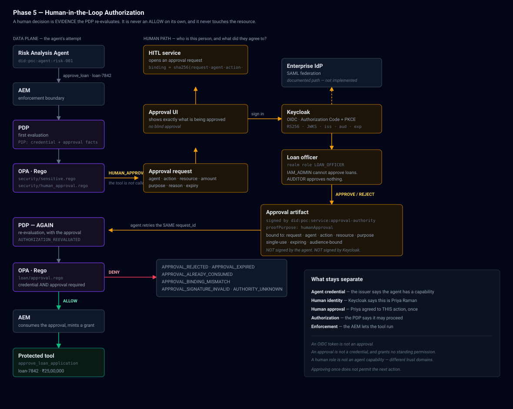

# Phase 5 Architecture — Human-in-the-Loop



The security reasoning lives in
[HITL_SECURITY_MODEL.md](HITL_SECURITY_MODEL.md). This document is the map:
what was built, where it lives, and how a request moves through it.

---

## 1. The flow, end to end

```
Risk agent  ──▶ AEM ──▶ PDP ──▶ OPA
                                 │  sensitive action, unapproved
                                 ▼
                       HUMAN_APPROVAL_REQUIRED          the tool is NOT called
                                 │
                       HITL service opens an approval request
                                 │
                       Approval UI ──▶ Keycloak (OIDC + PKCE)
                                 │
                       Loan officer sees agent · action · loan · ₹25,00,000
                                 │
                       APPROVE ──▶ approval artifact
                                     signed by did:poc:service:approval-authority
                                 │
Risk agent retries the SAME request_id
                                 │
            AEM ──▶ PDP ──▶ OPA  ◀── the approval, as a verified FACT
                                 │
                               ALLOW
                                 │
            AEM consumes the approval, mints a grant
                                 │
                      approve_loan_application(loan-7842)
```

The human never touches the resource. Two full policy evaluations sit between
their click and the loan changing state.

---

## 2. Components

| Module | Responsibility | Does **not** |
|---|---|---|
| `app/humans/oidc.py` | validate a Keycloak token; produce a `HumanIdentity` | decide anything |
| `app/humans/principals.py` | the minimal person record, for audit | store roles for authorization |
| `app/hitl/authority.py` | the approval-signing service principal | administer anything |
| `app/hitl/artifact.py` | build, sign and verify the artifact; the binding | decide whether it permits |
| `app/hitl/service.py` | request, decide, verify, consume; the state machine | authorize the approver |
| `app/hitl/presentation.py` | what the human is shown | trust anything the caller said |
| `app/api/routes/hitl.py` | the HTTP surface | contain a privilege rule |

Each boundary is deliberate. The one place the service could have decided
whether a human may approve — it delegates, to the same PDP everything else
uses.

### Deployment note

The HITL service is a **module and router inside the IAM API**, not a separate
process. The diagram shows it as its own box because it is its own *trust*
boundary — its own signing key, its own state machine — but running it as an
eighth process on this host would buy separation the POC cannot demonstrate.
The boundary that matters is the key, and that is real.

---

## 3. Data

| Table | Holds |
|---|---|
| `human_principals` | subject + issuer (unique together), provider, display fields, local status, `last_seen_roles` (audit only) |
| `approval_requests` | the binding, the presentation, the lifecycle, the approver, the signed artifact, `session_id` (NULL, reserved for Phase 9) |

Migration `f01a7fd3e257`. Unique constraints on `(issuer, subject)` and on the
artifact `nonce`. Nothing secret is stored.

---

## 4. Policy

| Policy | Version | Package | Decides |
|---|---|---|---|
| `sensitive-action` | **v2** | `agentic_iam.authz` | escalate a sensitive action **while unapproved** |
| `human-approval` | v1 | `agentic_iam.authz` | what an approval verdict means |
| `loan-approval` | v1 | `agentic_iam.authz` | ALLOW with credential **AND** approval |
| `cp-humans` | v1 | `agentic_iam.control_plane` | human roles: approval and S-7 |

`sensitive-action` went to v2 because its behaviour changed: the escalation is
now conditional on the action being unapproved. The version is written onto
every decision it produces, so an audit row identifies which revision decided.

All four were validated against the real OPA — 22 control-plane scenarios and
16 data-plane scenarios — before any Python was written against them.

---

## 5. HTTP surface

| Endpoint | Auth | Notes |
|---|---|---|
| `GET /api/v1/hitl/config` | none | public OIDC parameters; a public client has no secret |
| `GET /api/v1/hitl/health` | none | provider reachability and the signing authority |
| `GET /api/v1/hitl/me` | OIDC | identity only — never a statement of permission |
| `GET /api/v1/hitl/approvals` | none | the queue: what agents want, no resource data |
| `GET /api/v1/hitl/approvals/{id}` | OIDC + PDP | records `APPROVAL_VIEWED` |
| `POST /api/v1/hitl/approvals/{id}/decide` | OIDC + PDP | `LOAN_OFFICER` for loan decisions |
| `POST /api/v1/hitl/approvals/{id}/cancel` | OIDC + PDP | withdraw without deciding |
| `GET /api/v1/hitl/humans` | none | who has authenticated; no secrets |

Every mutating route uses the **Phase 4.5 control-plane guard unchanged**. Phase
5 added a principal *type* to it, not a second administrative surface.

---

## 6. The console

`Approvals` tab, with `Sign in` in the header.

* Authorization Code + **PKCE (S256)** directly against Keycloak; the backend
  holds no client secret and mints no session cookie.
* `state` is verified before the code is exchanged, and the code is stripped
  from the address bar either way.
* The token is attached as a bearer to every API call and lives in
  `sessionStorage` — it dies with the tab.
* The approval card shows agent, DID, action, resource, **amount**, purpose,
  attested capabilities, the policy reason, and both expiries.
* The UI never pre-judges permission. It offers the buttons to a signed-in
  `LOAN_OFFICER` and the server refuses anything else on its own authority.

The live trace gained 12 Phase 5 event types.

---

## 7. Known gaps

1. **SAML is a documented path, not a demonstration.** Keycloak is the SP and
   the application never sees an assertion, so federating a real IdP is realm
   configuration with no code change — but no second IdV was stood up.

2. **The browser holds the token in `sessionStorage`.** Standard for a public
   SPA client, and standard in its weakness: anything that can read the tab can
   take it. There is no refresh-token rotation and no server-side session,
   because sessions are Phase 9.

3. **Approval latency is dominated by the PIP**, which re-verifies every
   credential the subject holds on each authorization call — ~245ms of the
   ~531ms cycle. Pre-existing from Phase 4, not introduced here, and unchanged
   because caching credential validity is a correctness decision that belongs
   with the trust engine.

4. **One human approves.** No dual control, no four-eyes, no delegation and no
   escalation-on-timeout. An expired request simply expires.

5. **Approval requests are not pushed.** The console polls every 4s. There is
   no notification channel, so a real deployment would want one.

6. **The approval authority key never rotates.** Rotating it would invalidate
   every artifact already issued; doing that safely needs a key-history model
   the POC does not have.

7. **`LOAN_OFFICER` may approve any loan.** No amount thresholds, no
   segregation by branch or portfolio. The policy hook is there —
   `input.target` already carries the action — but no such rule is written.

---

## 8. Verifying it

```
docker compose up -d postgres redis opa keycloak
scripts/run_local.sh
python3 scripts/phase5_gate.py        # 67 checks against the live system
```

```
cd backend && .venv/bin/python -m pytest \
    tests/test_oidc_human_identity.py \
    tests/test_approval_artifact.py \
    tests/test_hitl_security_matrix.py
```

123 tests covering token validation, the artifact, the state machine, the race,
and the numbered security matrix.
